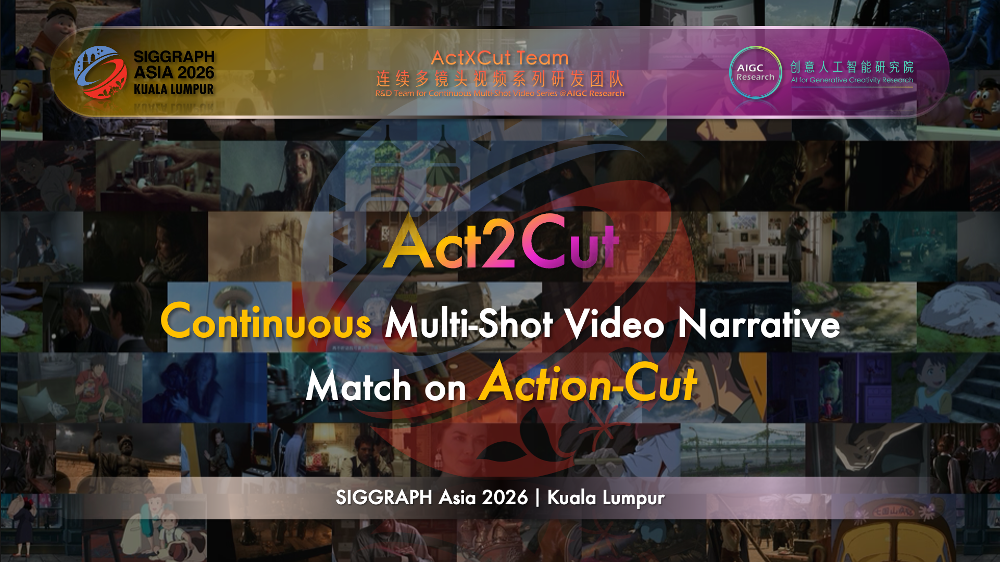

<h1 align="center">
</h1>

<h1 align="center">
🎬 Act2Cut: Continuous Multi-Shot Video Narrative Match on Action-Cut
</h1>

<h3 align="center">SIGGRAPH Asia 2026</h3>

<!-- <p align="center">
  <b>English</b> | <a href="README_CN.md">简体中文</a>
</p> -->

<div align="center">
  <p>
    <a href="https://journey-zhuang.github.io/">Cailin Zhuang</a><sup>1,2,3,4,*&dagger;</sup>&nbsp;&nbsp;
    <a href="https://scholar.google.com/citations?hl=zh-CN&amp;user=V47Xa8IAAAAJ">Yaoqi Hu</a><sup>1</sup>&nbsp;&nbsp;
    <a href="https://scholar.google.com/citations?hl=zh-CN&amp;user=azjmKy8AAAAJ">Zheng Dong</a><sup>1</sup>&nbsp;&nbsp;
    <a href="https://scholar.google.com/citations?user=vNCnDiMAAAAJ&hl=en">Siyu Zhu</a><sup>3</sup><br>
    <a href="https://openreview.net/profile?id=~Shiwen_Zhang1">Shiwen Zhang</a><sup>2</sup>&nbsp;&nbsp;
    <a href="https://scholar.google.com/citations?user=YDl1M80AAAAJ&amp;hl=en">Haibin Huang</a><sup>2,&dagger;</sup>&nbsp;&nbsp;
    <a href="https://openreview.net/profile?id=~Chi_Zhang14">Chi Zhang</a><sup>2</sup>&nbsp;&nbsp;
    <a href="https://scholar.google.com/citations?user=ahUibskAAAAJ&amp;hl=zh-CN">Xuelong Li</a><sup>2,&Dagger;</sup>
  </p>
  <p>
    <sup>1</sup><a href="https://aigcresearch.github.io/">ActXCut Team, AIGC Research</a>&nbsp;&nbsp;
    <sup>2</sup>Institute of Artificial Intelligence, China Telecom (TeleAI)<br>
    <sup>3</sup>Fudan University&nbsp;&nbsp;
    <sup>4</sup>ShanghaiTech University
  </p>
  <p>
    <sup>*</sup>Work done during internship at TeleAI.&nbsp;&nbsp;
    <sup>&dagger;</sup>Project Lead.&nbsp;&nbsp;
    <sup>&Dagger;</sup>Corresponding author.
  </p>
</div>

<p align="center">
  <a href="https://aigcresearch.github.io/Act2Cut.github.io/"></a> &ensp;
  <a href="https://aigcresearch.github.io/Act2Cut.github.io/Act2Cut-arXiv_compressed.pdf"></a> &ensp;
  <a href="https://github.com/AIGCResearch/Act2Cut"></a> &ensp;
  <a href="https://huggingface.co/datasets/AIGC-Research/ActCutVid"></a> &ensp;
  <a href="https://huggingface.co/AIGC-Research/Act2Cut"></a> &ensp;
  <a href="https://huggingface.co/datasets/AIGC-Research/ActCutBench"></a>
</p>

<p align="center">
  
</p>

## 🔥 Updates

- [ ] Model refinement ongoing; open-source release actively progressing.
- [x] Act2Cut was accepted to **SIGGRAPH Asia 2026**. The [presentation and poster](https://aigcresearch.github.io/Act2Cut.github.io/#poster) are scheduled for **December 2, 2026, 4:30–5:35 PM local time**, in the *Directing the Video* session at Conference Hall 1, Level 3, Kuala Lumpur Convention Centre.

## 📌 TL;DR

Act2Cut is a unified framework for **continuous-action cinematic multi-shot video generation**. It focuses on *Match on Action*: after a camera cut, the next shot should continue the same physical action state and motion flow instead of resetting, flickering, or breaking motion logic.

## ✨ Highlights

### Model Architecture
- **GLoS-RoPE** models global action timeline, local shot progression, and explicit shot identity in one temporal positional encoding.
- **SCM (Shot Causal Mask)** treats multi-shot videos as visual sequences, allowing later shots to inherit actions from preceding shots while blocking future-shot leakage.
- **HCM (Hierarchical Context Mask)** separates global story, local cinematography, and transition descriptions to reduce semantic confusion.
- **Transitional Boundary Enhancement** uses post-training to strengthen action-state consistency across shot boundaries, from the ending frame of the previous shot to the starting frame of the next shot.
- **Unified Multi-task Tuning** supports *text-to-video*, *image-to-video*, *storyboard-to-video*, and *video-to-video* generation or prediction in one framework.

### Dataset and Benchmark

- **ActCutVid-1M** is a hierarchically annotated multi-shot video dataset for action-cut video generation task.
- **ActCutBench** is a benchmark for narrative consistency, visual coherence, action continuity, and cinematographic alignment.

## 📑 Supported Tasks

Act2Cut entry points in this repository use **Wan2.2-TI2V-5B** at `1280x704` by default, natively supporting both Text-to-Video and Image-to-Video within a single model.

### Generation Task

| Task | Input | Output |
| --- | --- | --- |
| 📖 Text-to-Video (T2V) | Text Prompt | Multi-shot video |
| 🖼️ Image-to-Video (I2V) | First-frame + Text Prompt | Multi-shot video |
| 🎬 Storyboard-to-Video (S2V) | First-frame Per-shot + Text Prompt | Multi-shot video |
| 📹 Video-to-Video (V2V) | First-shot Video + Text Prompt | Multi-shot video |

* Text Prompt: Global Setting, Global Action, and Per-shot Cinematography

### Future: Prediction Task
| Task | Input | Output |
| --- | --- | --- |
| 📖 Text-to-Video (T2V) | Text Prompt | Next-shot video |
| 📹 Video-to-Video (V2V) | First-shot Video + Text Prompt | Next-shot video |

* Text Prompt: Global Setting, Global Action, Per-shot Cinematography, and Transitional Cinematography

## 🤗 Acknowledgement

This project is built upon:

- [DiffSynth-Studio](https://github.com/modelscope/DiffSynth-Studio)
- [Wan](https://github.com/Wan-Video/Wan2.2)
- [MultiShotMaster](https://github.com/KlingTeam/MultiShotMaster)
- [HoloCine](https://github.com/yihao-meng/HoloCine)

We thank the authors for their excellent work.

## 🌟 Citation

If you find Act2Cut useful, please cite our [paper](https://dl.acm.org/doi/10.1145/3829340.3842179):

```bibtex
@inproceedings{zhuang2026act2cut,
  author    = {Zhuang, Cailin and Hu, Yaoqi and Dong, Zheng and Zhang, Shiwen and Huang, Haibin and Zhang, Chi and Li, Xuelong},
  title     = {Act2Cut: Continuous Multi-Shot Video Narrative Match on Action-Cut},
  booktitle = {Proceedings of the SIGGRAPH Asia 2026 Conference Papers},
  year      = {2026},
}
```

## License

This project is released under the [Apache-2.0 License](LICENSE).
